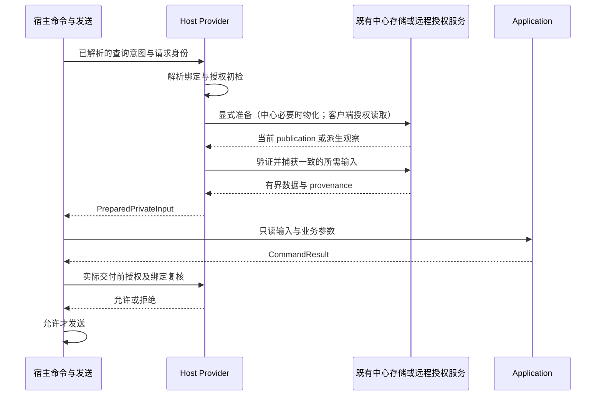

# Phase 2F-D0.5 — u0 Materialization Boundary Design

日期：2026-10-13。状态：**PHASE_2F_D0_5_DESIGN_COMPLETE**。

本阶段只完成设计。依据 D0 Taiko `6e6d431`、Sakura `e90fafd` 的源码及验收记录；不把功能分支等同于生产运行树。未修改代码、包、Writer、storage、数据库或生产；未执行物化、真实私人数据读取或部署。本设计不授予 D1 通过、私人命令迁移完成或全量 Application 完成标记。

## 1. 决策与六项回答

选择**方案 C：宿主显式准备，存储负责物化，Application 消费已准备的只读输入**。保留中心现有按需 u0 物化及客户端现有远程派生读取，统一上层接口的语义，不强制统一两端持久化方式。

| 必答问题 | 决定 |
| --- | --- |
| Application 是否允许直接触碰 Writer？ | **不允许。** 不持有 PublicationStore、可写目录、stage/publish、事务、更新凭据或能隐式调用物化的 callback。D0 纯合并内核继续只接收数据、combo 映射与 clock。现有 Ports 是兼容接口，不能仅凭 Callable 类型认定其只读。 |
| u0 materialization 属于哪一层？ | **持久化物化属于 Storage Layer。** Host Provider 的准备阶段决定是否调用并负责授权与输入；Application 只拥有合并计算策略。Host Provider 不复制存储协议，Storage 不推断聊天身份或决定用户授权。 |
| 查询是否允许产生写入？ | **用户发起的中心查询可以在显式准备阶段触发既有派生物化；Application 的查询/计算阶段不可以。** 不允许因此更新真实成绩、绑定、可见性或同步上游。存储恢复和锁文件属于另一个已存在的基础设施副作用，不能称为物理零写入。 |
| 中心和客户端如何共享接口？ | 共享请求、已准备输入及结果的语义；中心本地适配器和客户端远程适配器分别实现。复用现有 Application 发行体系，不创建包、服务或新 HTTP 协议。下文名称为设计术语，尚非已实现 API。 |
| 授权检查位于哪里？ | 宿主入口初检；Host Provider/中心服务在取得实际数据时作权威验证；宿主在发送私人结果前复核。Storage 锁、dependency hash、sourceView、缓存和 Application 均不提供授权证明。 |
| 如何保持 hash、history、current 与行为？ | 冻结现有 recipe、成员有序向量、profile 选择、合并规则、时间及发布协议；在已捕获的同一视图中读数据；保留每个宿主自己的输出语义并做新旧差异验收。不得用客户端派生结果替换中心持久化历史来冒充等价。 |

“只读”分三层使用：Application 无持久化能力；业务读取不新增真实成绩/绑定；底层文件系统是否产生任何写入。三者不同。本设计只对第一层作严格能力约束，对第二层限定允许的派生准备，对第三层明确保留既有恢复与锁行为。

## 2. 已确认的源码事实

### 2.1 bind resolution 与四类查询

中心 `plugins/taiko.py:_resolve_read_bind_target` 先解析请求身份、绑定与可见性；选中 u0 后调用 `materialize_merged_bind_userdata`，再返回虚拟 ID。因此它目前不是纯绑定查询。`_resolve_read_bind_target_safe` 只是将既有合并异常转成错误结果，并没有消除写入。

| 查询 | 中心 D0 调用与输入 | 客户端 D0 调用与输入 | 设计约束 |
| --- | --- | --- | --- |
| tinfo | `music_info_handle` → bind resolution/可能物化 → `execute_score` → 宿主 `generate_score_image`；依赖曲目解析、current 与图片资源 | 中心绑定解析、current 读取，再由宿主成绩 renderer 生成结果；发送出口有复核 | 提供授权后的 current、profile 与所需公开曲库/资源；渲染不得凭 user_id 再触发物化或改换数据视图 |
| B30 | `taikob_handle` → 参数准备 → bind resolution/可能物化 → `execute_b30`；默认汇总图涉及历史趋势，其他分支使用 current/计算结果及 v1/v2 曲库 | current 读取；默认汇总分支调用 `ensure_userdata_view_available` 配对 current/history；维度、v2 分支保留各自规则 | 有历史需求时提供同一观察版本的 current/history；还须单独隔离既有 daily archive 副作用，不能只拆 u0 就宣布 B30 只读 |
| progress | 参数、页码与类型选择后解析绑定，再通过 `execute_progress` 调用宿主段位/定数/过关/星级/列表 renderer | 准备 current 后调用对应 renderer，发送前复核 | 使用当前已授权成绩与对应公开 catalog；不为无历史需求的进度额外加载私人历史，不改变页码、筛选、FC/DF 或空结果规则 |
| recommendation | 绑定解析后 `execute_recommendation`；普通/目标计算与 renderer 仍由宿主 Ports 提供 | 普通/目标推荐的宿主计算、current 与数据源处理保留，并有发送前复核 | 准备 current、公开 rating/目标资料或已有预计算结果；不迁移 Writer，不因解释 DTO 已在 Application 就宣称整条推荐调用链无 IO |

这是能力分类，不是四条调用链已经全部改成显式输入的声明。现有 `CommandContext.user_id` 和 renderer/compute Ports 仍可能继续获取宿主数据；后续迁移必须逐一审核真实实现，不能把有写入的函数改名为 read 即视为完成。

### 2.2 存储与时间语义

`taiko_store.merged_materialization.materialize` 保持以下现状：

1. 有界 admission；按排序后的 Source ID 顺序取得成员 shared 锁，但计算和 hash 使用原始成员顺序。
2. 验证成员 current、已发布状态与输入大小，缺失成员按绑定 slot 报错；不在读请求中自动 adopt 未管理数据。
3. 计算 dependency hash，取得输出 exclusive 锁；匹配时直接返回，其他情况按既有规则 stage/publish。
4. 首次或非增量路径构建 current 与完整派生历史；首次 current 的 `_meta.ts` 使用既有 clock，不能擅自统一为成员最大 mtime。
5. 增量且业务内容变化时使用成员 current 的最大既有文件 mtime 作为观察时间并追加历史；仅依赖变化、内容未变时发布新 receipt，不伪造成绩观察点。相同 dependency 的热请求不产生新代。

`ScoreReadView` 只在其 lease 内有效。托管数据从 manifest 指向的 canonical object 读取；兼容 `userdata/<id>data.json` 和历史路径不是绕过 canonical 验证的备用权威。

`PublicationStore` 构造可创建内部目录，取锁可创建 lock 文件；`shared()` 发现 pending publication 时会先取得 exclusive 恢复所有权，执行 `_recover()` 后再回到 shared。因而“调用 shared”不等于“文件系统没有写入”。本设计不禁用、复制或重写恢复。

### 2.3 两端不能混同的现状

客户端 `taiko_bot/userdata_provider.py` 使用 `fetch_private_read`；即使命中内存缓存也向中心发条件请求。`ensure_userdata_view_available` 检查两次响应的 sourceView 一致，最多两轮，使用同一个 180 秒总 deadline；历史要求 `raw-v1`。缓存失败不允许离线成绩兜底。

补充审阅 Viewer 仓库 `56aa05a` 的 `merged-source-read.ts`：远程 u0 路径由 worker 在成员 shared views 上派生结果，以中心 principal/Source 授权及绑定复核约束读取，没有调用中心原生 u0 materializer。该服务的客户端组合规则排除 manual 成员并采用既有 profile index clamp；中心原生绑定路径不能据此改成同一规则。虚拟 ID 编码也保留各自既有规则。

远程 merged sourceView digest 包含 principal、bindings、成员 views、profileSource、ruleRevision；它不是原生 u0 的持久化 dependency hash，更不是单账号 publication ID。共享接口必须区分这些标识的含义。

B30 的中心 `b30_render.py` 调用 `build_daily_rating_points`；`score_calculator.py` 的趋势路径可能打开 daily archive 并执行 `store_measurement`。本次仅记录这一剩余副作用，不修改 daily、renderer 或它们的调用位置，也不把它隐含批准为未来 Application 的能力。

## 3. 三个方案及选择

| 方案 | 边界 | 好处 | 代价与结论 |
| --- | --- | --- | --- |
| A：Application 调用 Writer Port | Application 通过注入的 ensure/materialize callback 触发存储 | 最少表面接线，容易沿用按需物化 | Application 实际决定写入时机；callback 隐藏了 Writer，不能满足私人只读输入边界。**不选**。依赖注入不改变操作的写入性质。 |
| B：查询完全不物化 | 全部请求内纯合并，或只读预先物化结果，由真实写入后/后台任务维护 u0 | 查询侧更容易约束无业务写入 | 请求内重算会改变中心增量历史、首次 current 时间和持久化 receipt；只读现成结果会引入缺失/陈旧窗口。后台方案还需要绑定/profile/规则变化触发器及新的运维约束。**不选**，本阶段无权更改这些协议和行为。 |
| C：宿主显式准备 + Storage 原样物化 + Application 只读输入 | 中心宿主在进入 Application 前按既有行为准备 u0；客户端维持授权远程派生；随后交付固定输入 | 保留当前产品行为，不搬 Writer，不强制两端改持久化方式；副作用和授权责任可见 | 必须处理准备到读取的竞争、剥离 renderer 的隐式二次读取，并单独解决 B30 archive 边界。**选择**，这些是后续实现 Gate，不是本轮已完成项。 |

C 不是把 A 的 callback 换个名字：Application 完全拿不到准备能力；准备失败时不调用 Application；读能力也不能“缺数据就 ensure”。真正的编排入口仍在宿主。若将来要求 Application 自己控制整个准备流程，则与本决策冲突，必须重新评审。

## 4. 选定方案的责任与接口

### 4.1 职责分配

- **宿主入口/发送适配器**：平台 event → actor/target；保留命令解析和错误优先级；调用准备；构造 Application 请求；在实际交付私人结果前复核并发送。
- **Host Provider 准备阶段**：解析绑定、可见性、slot、成员顺序与 profile 来源；验证必要权限；中心在需要时显式调用既有 materializer；客户端使用既有授权 HTTP 路径；捕获数据与 provenance。它是允许有既有副作用的宿主操作，不叫纯 read。
- **Storage Layer**：现有 publication lease、对象验证、物化、stage/publish、恢复和兼容投影。只接收宿主确定的输入；锁并不证明这些输入已经授权。
- **Application**：已有纯合并/查询/解释与使用已准备输入的业务计算；如使用 renderer Port，Port 只能消费准备好的数据及声明的公开资源，不得访问私人存储或触发 Writer。

### 4.2 共享逻辑接口（仅设计，不新增类型或协议）

| 概念 | 必要内容 | 所属与限制 |
| --- | --- | --- |
| ReadIntent | 四类命令需要的 current/history/派生输入范围；目标身份与宿主 profile | 宿主根据实际分支确定；不能由客户端任意提交成员列表并获得授权 |
| ResolvedReadTarget | principal、实际 Source 或虚拟目标、slot、**有序**成员及 source、profile 来源、已有可用绑定观察信息 | 宿主持有；解析本身将来应与物化分离。并非授权票据，也不新增数据库 revision 字段 |
| PreparedPrivateInput | 已准备 current；按需 history/已有趋势结果；本次读取的观察标识与表示类型；必要公开 catalog | Application 只消费数据，宿主保留授权/provenance。无 Writer、可写路径、存储 lease 或更新 callback |
| Read provenance | 原生 publication 标识/既有 dependencyHash，或远程 sourceView；绑定组合、所需权限范围、所用公开规则版本 | 请求内宿主状态，用于检查，不改 userdata 格式；不同表示不能互相伪装成同一个 token |
| CommandResult | 既有文字/图片/空结果及发送方式 | 不带“已经永久授权”断言；宿主控制交付 |

“不可变输入”是所有权约束：不暴露可变共享缓存给计算修改；在有界读取阶段取得自有数据，退出 lease 后不能继续使用旧 ScoreReadView。避免把整份无限历史 deep-copy 进多个 DTO，沿用现有字节、历史数量、超时和 admission 上限。若确需流式输入，生命周期和无持久化能力必须另行证明，不能把裸 store reader 交给 Application。

中心与客户端共享的是这个逻辑约定和 Application 能力，不要求共享 SQL、文件路径、虚拟 ID 编码或网络实现。未来具体 DTO 若需代码落地，应放在既有包的适当模块并独立授权；本轮不更改 Application/Contract 版本，不新建发行包。

## 5. 准备、读取、计算、发送的时序

图中的准备和读取是概念阶段，不要求把既有原子操作拆成新的非原子步骤；远程已验证的响应可以一次完成两阶段。保留各命令现有参数/绑定/资源错误的优先级，不能为统一图示而提前物化无效请求或跳过已有必需错误。

### 5.1 中心物化返回后的竞争

现有 materializer 返回路径和成员/profile 模型，不返回一个仍被锁保护的跨调用 view。因此不能“materialize 返回后直接打开兼容路径”，也不能只凭返回路径承诺是本请求那一代。

后续 Host Provider 应在不修改 Writer 协议的前提下，以现有 lease/manifest 捕获所需 current/history，并核对其 dependency 与本次已授权组合及成员 publication 向量。验证必须沿用第 7 节的唯一规则，不发明第二套 hash，也不把路径存在或 mtime 当作证明。具体只读验证的复用点须在实现阶段审计；当前没有已实现的 prepare receipt API。

不匹配时先释放全部 view/锁，再回到宿主准备阶段作有界重试；持续变化则沿用暂不可用错误，不在读 callback 内悄悄再次物化、不无限循环。不同请求可能合法捕获不同版本；要求一次结果内部一致，不要求发送时成绩永远是全局最新。

禁止持有 SQL 事务等待 Source 文件锁，禁止持有输出 shared 锁再调用取得 exclusive 的 materializer，也禁止重入同一 store 锁。现有 materializer 的排序成员 shared → 输出 exclusive 顺序不变。任何新增的绑定证明与 lease 组合都必须有明确锁序及撤权时序测试；如必须改变 Writer/锁协议才能实现，后续实施应停下报告阻断。

## 6. 授权位置与竞争边界

1. **入口初检**：验证实际 actor、目标身份、自查/他查、绑定和可见性。没有权限或绑定缺失时，不为其开始 u0 私人成绩准备。资源可用与否不构成授权。
2. **取得数据时的权威验证**：中心宿主/中心服务验证 principal 与实际每个成员 Source 的访问权限；history 派生包含 current 时须同时满足 history/current 所需权限。成员 ID、profile 来源和 source 类型以中心规则为准，不能信任客户端传入的组合。
3. **读取一致性检查**：授权证明覆盖捕获的绑定组合与数据观察；组合变化不能仅因虚拟 user_id 未变而继续使用旧结果。授权快照与成绩快照是不同概念，不得以 dependencyHash 或 publication unchanged 代替撤权检查。
4. **发送前复核**：所有可能交付私人图片、文字、文件及私人错误信息的出口，都由宿主在尽量靠近实际发送处重新检查。准备/渲染后权限撤销、绑定成员/profile/slot/source 变化时，丢弃结果并按既有拒绝/重试语义处理；不能把旧结果改贴新身份后发送。

客户端原 35 处 `_require_private_send_authority` 不因本设计而删除或合并。现有 `has_current_send_authority` 比较 identity_key、user_id、source、is_virtual，并通过 resolver 重新取数据；这些字段对同一个 u0 的成员/profile 变化不一定充分。因此“35 处未改”只证明保留现状，不能证明未来共享接口已覆盖完整组合复核。未来复核还需比较已准备目标的有序成员、profile 与中心当前组合；不要求为此新增数据库字段。

中心 D0 的 `_deliver_application_command` 没有展示同等的独立发送前复核，不能从函数注释推定它已经安全完成该步骤。中心撤权/发送 Gate 仍待实现审计。复核接口也不能复用一个会重新物化的 resolver 并声称是纯授权检查。

客户端每次私人读取（包括 304）仍须经过中心的实时权威检查；401/403、无效 observation 或离线时不能回退历史缓存。不要让授权凭据、SQL handle 或 token 进入 Application DTO。

跨平台网络发送与中心撤权不在同一个原子事务中：设计承诺在规定的验证点拒绝已失效权限，并尽可能紧邻实际交付复核；不宣称能撤回已发出的消息，或在没有现成协议支持时保证跨服务“绝对零时间窗”。此边界必须在未来验收中明示。

## 7. 必须保持的兼容性

### 7.1 dependency hash

原生 u0 保持 `native-u0-incremental-v1` recipe；依赖对象仍为 principal、按原顺序排列的 `(identity, publication)`、profile、rule。继续使用既有 `json.dumps(..., sort_keys=True, separators=(",", ":"))` 的字节约定和 SHA256。

rule revision 继续使用 `center-merged-bind-v1`、historyAdapter 1、`max-file-mtime-v1` 与既有排序后的 combo 三元组。combo 的来源、解析、失败回退和进程缓存规则不变。`max-file-mtime-v1` 这个 policy 名称不授权改写首次物化 current 的 clock 行为。

锁获取时排序，不代表成员计算或 dependency 向量可以排序/去重。更换成员顺序、profile、成员 publication 或 combo rule 的影响按原规则保留。授权 revision 不混入该 hash；客户端的 sourceView/ETag 也不替代它。

### 7.2 history semantics

保留 full/delta 重建、无 base 的增量处理、songs_removed、同时间点文件名顺序、profile 回退、微秒文件名和末尾 current 的追加顺序。不得把 append current 强制排序成新的历史，不得把请求发生时间当游玩时间。

中心持久化路径继续保留既有增量历史与 dependency receipt 规则，成员变化引发的非增量路径也照旧。客户端继续保留远程 `raw-v1` 派生历史及它自己的 sourceView 一致性要求。两种历史表示都标明来源；“接口相同”不等于文件名、持久化生命周期和每个时间戳在两端必然相同。

B30 daily archive 不是 u0 history 的同义词。若后续需要保持其按需补算行为，必须把有副作用的准备明确留在宿主，而 Application 只接收已准备结果；本设计没有批准搬迁或重写 archive Writer。未证明 renderer 已不再隐式写 archive 前，B30 不通过纯读取迁移 Gate。

### 7.3 current projection 与用户行为

- 托管 current/history 取自同一捕获 publication；不能把一代 current 与另一代 history 拼接。远程 current/history 的 sourceView 不同则按既有有界策略重取或报错。
- 兼容投影缺失/被篡改不使其成为权威；canonical object 损坏不能读取旧兼容文件冒充成功。未管理源与旧 u0 输出的 adopt 限制不变。
- 保留 u0 identity 格式、成员选择与手工来源规则、profile 来源、同分先到优先、stage_cnt 汇总、曲目排序、achievement、时间格式与未知字段处理。
- 保留未绑定、隐藏、缺失成员、数据损坏、资源不足及暂不可用的既有消息和异常映射；不能吞掉缺失成员后改成“部分合并”。
- 保留四类命令的参数、v1/v2 选择、推荐限制、进度页码、图片/文字、发送方式及平台差异。不新增后台更新、定时刷新、隐式真实成绩同步或降级为旧数据的流程。

## 8. 后续实施 Gate（本轮均未执行）

| 验证 | 必须证明 |
| --- | --- |
| 纯能力边界 | Application 不能触达 Writer/私人成绩文件/SQL；现有计算与 renderer Ports 不通过 user_id 再次触发准备 |
| u0 兼容性 | 延用 D0 oracle；首次、热请求、成员更新、顺序/profile/规则变化、仅 receipt 更新时，hash、current/history 与错误一致 |
| 准备到读取竞争 | 物化返回后成员更新或另一请求切换 profile 时，捕获明确且一致的版本；不死锁、不混代、不无限重试 |
| 授权竞争 | 准备前、读取中、渲染后、发送前撤权；同 u0 ID 下成员/profile/source 变化；缓存命中/304 也不能绕过授权 |
| 存储边界 | PublicationStore 锁、恢复、stage、publish、原子协议不改；恢复副作用与业务物化分别记账，不能以 shared 名称宣称物理零写入 |
| 四类命令 | 两端真实结构合成输入及图片/文字差异验收；B30 包含 history、daily archive 与跨版本输入边界，不以 tinfo 通过代替 B30 通过 |
| 原有范围 | 九个公开入口和 35 处客户端复核保持；无生产 userdata 读取，测试经既有隔离入口，无生产改动 |

这些是未来独立授权阶段的完成条件，不是让本轮继续实施的计划。若保持行为必须改持久化协议、Writer、storage 或生产 P0，应停下说明阻断，不能在“Provider 适配”名义下扩大范围。

## 9. 源码依据与完成范围

- [D0 交付记录](u0-merge-kernel-decoupling.md)、[D0 验收记录](u0-merge-kernel-validation.json)。历史 119 tests/5 subtests、78/80 公共回归是 D0 证据，本设计没有重新执行或新增测试。
- Taiko `6e6d431`：`plugins/taiko.py`、`taiko_runtime/send_authority.py`、`taiko_bot/userdata_provider.py`、`taiko_bot/private_read_client.py`、`packages/taiko-application/src/taiko_application/commands/`。
- Sakura `e90fafd`：`taiko/plugins/taiko.py`、`taiko/plugins/utils/merged_bind.py`、`taiko/taiko_store/{merged_materialization,merged_read,publication,reader}.py`、`taiko/plugins/utils/{b30_render,score_calculator}.py`。
- Viewer `56aa05a` 的补充源码：`taiko_viewer/server/services/account/merged-source-read.ts`，只用于说明现有远程派生与授权机制，不声称该 checkout 即生产状态。

本轮只新增本设计文档，未修改两端实现、依赖声明或版本，没有创建新包、修改 Writer/storage/数据库/生产、合并 main、部署或重启。**PHASE_2F_D0_5_DESIGN_COMPLETE** 只表示设计交付完成；完成后停止。
